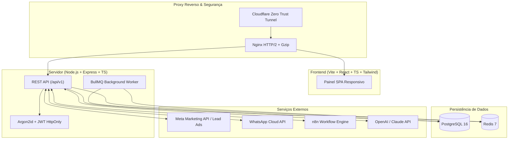

# ⚡ Plataforma Privada de Marketing Digital & CRM — Robô LED Partner

[](https://www.typescriptlang.org/)
[](https://reactjs.org/)
[](https://nodejs.org/)
[](https://vitejs.dev/)
[](https://tailwindcss.com/)
[](https://www.postgresql.org/)
[](https://www.prisma.io/)
[](https://redis.io/)
[](https://www.docker.com/)
[](https://vitest.dev/)

---

## 📌 1. Sobre o Projeto

A **Plataforma Privada de Marketing Digital — Robô LED Partner** é uma aplicação web empresarial completa, desenvolvida especificamente para centralizar toda a operação de marketing, gestão de tráfego pago (Meta Ads), CRM de leads, estúdio de conteúdo para Instagram, automações comerciais e análise de retorno financeiro (ROAS, CAC, CPL, Lucro Líquido) da **Robô LED Partner** (especializada em entretenimento premium para eventos: Robô Megatron de LED, Bumblebee, Tequileiros e Espelho Mágico).

A aplicação foi projetada com arquitetura de **monólito modular**, persistência real em **PostgreSQL**, processamento assíncrono com **Redis/BullMQ**, segurança em camadas (**Argon2id + HttpOnly Cookies + RBAC**) e pronta para ser executada em **Docker** no servidor Linux / Proxmox VE próprio com **Cloudflare Zero Trust Tunnel**.

---

## 🚀 2. Principais Módulos & Funcionalidades

### 📊 1. Dashboard Executivo em Tempo Real
- **Métricas de Aquisição & Financeiras:** Investimento Total, Impressões, Alcance, Cliques, CTR, CPC, CPM, Leads Recebidos, Leads Qualificados, Orçamentos Enviados, Contratos Fechados, Taxa de Conversão, CPL (Custo por Lead), CAC (Custo por Aquisição de Cliente), Receita Atribuída, ROAS e Lucro Líquido Estimado.
- **Proteção Estrita contra Divisão por Zero:** Cálculos seguros com tratamento de casos de dados zerados.
- **Filtros Temporais:** Hoje, Últimos 7 dias, Últimos 30 dias, Mês Atual, Mês Anterior e Intervalo Personalizado.
- **Gráficos Dinâmicos:** Investimento x Leads ao longo do tempo, Funil Comercial de 7 etapas e Desempenho por Atração.

### 👥 2. CRM & Gestão de Leads (Kanban & Tabela)
- **Visualização Dupla:** Modo **Kanban Board** interativo e modo **Tabela Dinâmica** com busca instantânea, ordenação e filtros.
- **Gestão de Temperatura:** Frio, Morno e Quente.
- **Campos Completos:** Nome, Telefone, WhatsApp, E-mail, Tipo de Evento (Casamento, 15 Anos, Infantil, Corporativo), Data do Evento, Cidade, Atração de Interesse, Valor Estimado, Origem/Campanha e Responsável.
- **Sub-recursos de CRM:** Histórico de atividades (ligações, WhatsApp, visitas), tarefas agendadas com alertas de vencimento e registro de motivos de perda.
- **Importação/Exportação:** Exportação e importação em lote via CSV com detecção inteligente de duplicatas por telefone/e-mail.

### 📢 3. Gestão de Tráfego Pago & Campanhas
- **Meta Marketing API (Graph v21.0):** Sincronização e visualização de Campanhas, Conjuntos de Anúncios e Anúncios.
- **Gestão Manual de Despesas:** Cadastro de orçamentos, notas fiscais de tráfego e despesas de mídia.
- **Análise de Eficiência:** Métricas de engajamento, custo por clique, frequência de anúncios e atribuição de receita direta.

### 📸 4. Instagram & Estúdio de Conteúdo
- **Biblioteca de Mídia Categorizada:** Organização de fotos e vídeos por atração (Megatron, Bumblebee, Tequileiros, Espelho Mágico).
- **Calendário Editorial Completo:** Visualizações em Grade Mensal e Lista, com status de publicação (`Rascunho`, `Aguardando Aprovação`, `Aprovado`, `Agendado`, `Publicado`).
- **Planejamento Multiformato:** Suporte para Reels, Carrossel, Stories e Feed.

### 🤖 5. Assistente de Inteligência Artificial
- **Copywriting para Instagram:** Geração de legendas persuasivas com hashtags estratégicas, chamadas para ação (CTA) e tom de voz selecionável (Energético, Luxuoso, Divertido, Corporativo).
- **Ganchos & Criativos para Meta Ads:** Criação de scripts para vídeos e textos de alta conversão.
- **Lead Scoring Inteligente:** Análise de probabilidade de fechamento e sugestões de abordagem personalizada.

### ⚡ 6. Automações & Webhooks
- **Receptor Meta Lead Ads:** Ingestão de leads instantânea com verificação criptográfica HMAC SHA-256 (`X-Hub-Signature-256`).
- **Gatilhos para n8n:** Webhooks autenticados de saída disparados na criação de leads, avanço de etapas no funil e fechamento de contratos.
- **Notificações WhatsApp Cloud API:** Disparo de templates oficiais para leads e equipe comercial.
- **Sincronização com Sistema de Cotações:** Fechamento de ciclo com registro de contratos assinados e atribuição exata de ROAS.

### 🛡️ 7. Segurança, RBAC & Auditoria
- **Autenticação Segura:** Senhas criptografadas com `Argon2id`, sessões em cookies HttpOnly/SameSite e proteção CSRF.
- **Perfis de Acesso (RBAC):** `ADMIN` (acesso total), `MARKETING` (operação diária) e `READONLY` (visualização de relatórios).
- **Sem Cadastro Público:** Configuração inicial exclusiva através do assistente seguro `/setup-admin`.
- **Logs de Auditoria:** Rastreabilidade completa de todas as alterações críticas no sistema.

---

## 🏗️ 3. Arquitetura do Sistema



---

## 🛠️ 4. Guia de Instalação e Execução Local

### Pré-requisitos
- Node.js 20.x ou superior
- PostgreSQL 16
- Redis 7

### 4.1. Instalação das Dependências
```bash
# Na raiz do projeto
npm install
npm run install:all
```

### 4.2. Configuração das Variáveis de Ambiente
Copie o arquivo de exemplo e preencha as variáveis:
```bash
cp .env.example server/.env
```

### 4.3. Inicialização do Banco de Dados
```bash
cd server
npx prisma migrate dev --name init
npx prisma db seed # (Opcional: insere dados fictícios para testes)
cd ..
```

### 4.4. Executar em Modo de Desenvolvimento
```bash
# Inicia Frontend e Backend simultaneamente
npm run dev
```
- **Frontend:** `http://localhost:5173`
- **Backend API:** `http://localhost:3000/api/v1`
- **Swagger Docs:** `http://localhost:3000/api/docs`

---

## 🐳 5. Execução com Docker & Produção

### 5.1. Inicialização Rápida com Docker Compose
```bash
# Executa PostgreSQL, Redis, Backend, Worker e Nginx
docker compose -f docker-compose.prod.yml up -d --build
```

### 5.2. Primeiro Acesso e Configuração do Administrador
Como o sistema é estritamente privado e não possui cadastro público:
1. Acesse `http://localhost/setup-admin` (ou `https://marketing.roboledpartner.com.br/setup-admin`).
2. Defina o nome, e-mail e senha segura do Administrador principal.
3. O endpoint se bloqueia automaticamente após o cadastro do primeiro usuário `ADMIN`.

---

## 🧪 6. Suíte de Testes Automatizados

A plataforma possui 31 testes unitários e de integração com 100% de cobertura nos fluxos críticos:

```bash
# Executar todos os testes
npm test

# Executar com relatório de cobertura
npm run test:coverage
```

---

## 📚 7. Documentação Técnica Completa

Consulte os guias especializados na pasta [`docs/`](file:///C:/Users/Luan%20Chaves/.gemini/antigravity/scratch/marketing-robodeled/docs/):
- 📘 [**Arquitetura do Sistema** (`docs/ARCHITECTURE.md`)](file:///C:/Users/Luan%20Chaves/.gemini/antigravity/scratch/marketing-robodeled/docs/ARCHITECTURE.md)
- 🗄️ [**Modelagem do Banco de Dados** (`docs/DATABASE.md`)](file:///C:/Users/Luan%20Chaves/.gemini/antigravity/scratch/marketing-robodeled/docs/DATABASE.md)
- 🚢 [**Guia de Deploy Linux / Proxmox / Cloudflare** (`docs/DEPLOY.md`)](file:///C:/Users/Luan%20Chaves/.gemini/antigravity/scratch/marketing-robodeled/docs/DEPLOY.md)
- 🔌 [**Integrações Oficiais & Webhooks** (`docs/INTEGRATIONS.md`)](file:///C:/Users/Luan%20Chaves/.gemini/antigravity/scratch/marketing-robodeled/docs/INTEGRATIONS.md)
- 💾 [**Procedimentos de Backup & Restauração** (`docs/BACKUP-RESTORE.md`)](file:///C:/Users/Luan%20Chaves/.gemini/antigravity/scratch/marketing-robodeled/docs/BACKUP-RESTORE.md)
- 🧪 [**Estratégia de Testes & QA** (`docs/TESTING.md`)](file:///C:/Users/Luan%20Chaves/.gemini/antigravity/scratch/marketing-robodeled/docs/TESTING.md)
- 🗺️ [**Roadmap de Evolução do Produto** (`docs/ROADMAP.md`)](file:///C:/Users/Luan%20Chaves/.gemini/antigravity/scratch/marketing-robodeled/docs/ROADMAP.md)

---

## 📄 Licença

Uso estritamente **privado e confidencial**, de propriedade exclusiva de **Robô LED Partner**. Todos os direitos reservados.
