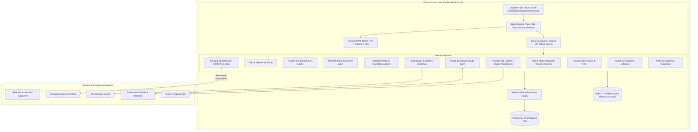

# Arquitetura do Sistema — Robô LED Partner Marketing & CRM

## 1. Visão Geral da Arquitetura

A plataforma **Robô LED Partner Marketing & CRM** foi concebida sob o padrão de **Monólito Modular em TypeScript**, garantindo alta coesão, acoplamento reduzido, facilidade de manutenção e máxima performance sem a sobrecarga operacional de microsserviços desnecessários.

---

## 2. Princípios de Design & Boas Práticas

1. **Separação Rígida em Camadas:**
   - **Routes:** Definição declarativa de endpoints e middlewares de autenticação/validação.
   - **Controllers:** Orquestração de requisição/resposta HTTP, sem regras de negócio embutidas.
   - **Services:** Lógica de negócio pura, isolada e testável unitariamente.
   - **Repositories / Prisma:** Camada de persistência relacional com integridade referencial estrita.
   - **Integrations / Adapters:** Clientes isolados para APIs externas (Meta Graph v21.0, WhatsApp Cloud, OpenAI).

2. **Segurança por Padrão (Zero Trust):**
   - Hashing de credenciais com **Argon2id** (resistente a ataques de força bruta por GPU/ASIC).
   - Sessões gerenciadas via cookies `HttpOnly`, `SameSite=Lax`, com flag `Secure` em produção.
   - Assinaturas de Webhook validadas via HMAC SHA-256 em tempo real.
   - Sanitização de entradas e prevenção contra XSS e SQL Injection através de consultas parametrizadas do Prisma e validação via schemas Zod.
   - Registro detalhado de logs de auditoria (`AuditLog`) para todas as ações administrativas e modificações em entidades críticas.

3. **Resiliência Matemática (Proteção Zero-Division):**
   - Todas as métricas de performance (CPL, CAC, ROAS, CTR, CPC, CPM, Lucro Líquido) possuem guardas matemáticas contra divisão por zero, retornando `0` de forma segura.

---

## 3. Comunicação & Fluxo de Dados

### 3.1. Recepção de Leads em Tempo Real
1. O lead preenche o formulário no anúncio do Facebook/Instagram (**Meta Lead Ads**).
2. O webhook da Meta envia a notificação para `/api/v1/webhooks/meta-leads`.
3. O middleware valida a assinatura no header `x-hub-signature-256` utilizando o `META_APP_SECRET`.
4. O backend busca os dados completos do lead via Graph API v21.0.
5. O lead é gravado no PostgreSQL com atribuição multi-touch (UTMs, anúncio, campanha).
6. O motor de regras de automação é disparado, enviando notificação para o WhatsApp dos noivos/contratantes e alertando a equipe comercial.

### 3.2. Sincronização de Tráfego Pago
1. O serviço `MetaAdsService` conecta-se à conta de anúncios configurada.
2. Faz o parsing dos relatórios diários de impressões, cliques, alcance, frequência e investimento.
3. Consolida as métricas na tabela `AdMetric` e recalcula KPIs agregados no Dashboard.
