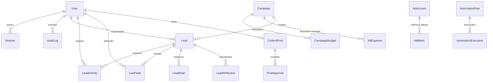

# Modelo de Dados & Banco de Dados — PostgreSQL & Prisma ORM

## 1. Visão Geral

O banco de dados relacional é implementado em **PostgreSQL 16** e gerenciado pelo **Prisma ORM**, estruturado com 22 modelos normalizados, integridade referencial rígida com Foreign Keys, índices otimizados para consultas de CRM e dashboards analíticos, e controle estrito de auditoria.



---

## 2. Dicionário de Modelos

### 2.1. Núcleo de Usuários, Sessões e Auditoria
- **`User`:** Contas de acesso ao sistema (`ADMIN`, `MARKETING`, `READONLY`). Senhas criptografadas com Argon2id.
- **`Session`:** Sessões ativas de login com token assinado, expiração, IP de origem e User Agent.
- **`AuditLog`:** Trilha de auditoria imutável registrando entidade alterada, ação (`CREATE`, `UPDATE`, `DELETE`, `LOGIN`, `SYNC`), dados antes/depois em JSON e ID do usuário.

### 2.2. CRM e Funil de Vendas de Leads
- **`Lead`:** Registro central da oportunidade comercial. Contém dados de contato, temperatura (`COLD`, `WARM`, `HOT`), canal de aquisição (`META_ADS`, `WHATSAPP_DIRECT`, `GOOGLE_ADS`, etc.), detalhes do evento (tipo, data, cidade, atração de interesse como *Robô Megatron LED*, *Bumblebee*, *Tequileiros*) e valor estimado.
- **`LeadActivity`:** Histórico de interações (`NOTE`, `CALL`, `WHATSAPP`, `PROPOSAL_SENT`, `STATUS_CHANGE`).
- **`LeadTask`:** Tarefas de follow-up com prazo de vencimento, prioridade e status de conclusão.
- **`LeadDeal`:** Propostas formais e contratos com distinção entre receita orçada, contratada e recebida.
- **`LeadAttribution`:** Modelo de atribuição multi-touch registrando parâmetros UTM (`utm_source`, `utm_medium`, `utm_campaign`, `utm_content`, `utm_term`), IDs do Meta Lead Ads e timestamp de cada toque.

### 2.3. Gestão de Tráfego e Campanhas
- **`Campaign`:** Campanhas de marketing com objetivo comercial, datas de início/fim e verba alocada.
- **`CampaignBudget`:** Ajustes e alocações periódicas de verba por canal.
- **`AdExpense`:** Registro de notas fiscais, despesas de anúncios manuais e custos operacionais.
- **`AdAccount`:** Contas de anúncios integradas do Meta Marketing API.
- **`AdMetric`:** Métricas diárias sincronizadas da Graph API (impressões, alcance, cliques, investimento, leads, CPC, CPM, CTR).

### 2.4. Instagram, Mídia Visual e Conteúdo Editorial
- **`MediaItem`:** Galeria categorizada por atração (*Megatron*, *Bumblebee*, *Tequileiros*, *Espelho Mágico*) com tags, URLs de mídia e tipo (foto/vídeo).
- **`ContentPost`:** Planejamento de publicações para Instagram (Reels, Carrosséis, Stories, Feed) com legenda, roteiro, data agendada e status (`DRAFT`, `PLANNED`, `APPROVED`, `PUBLISHED`).
- **`PostApproval`:** Fluxo de revisão e aprovação de conteúdo com comentários da liderança.

### 2.5. Automações, Integrações e Webhooks
- **`AutomationRule`:** Regras de negócio configuráveis (Gatilho -> Condições -> Ações no WhatsApp/n8n).
- **`AutomationExecution`:** Log de disparos de automações com status de sucesso/falha e payload de resposta.
- **`WebhookLog`:** Log de requisições de webhooks recebidas (Meta, WhatsApp, n8n, Cotações) para rastreabilidade e depuração.
- **`IntegrationConfig`:** Chaves de API e tokens criptografados das conexões externas.
- **`ConversionGoal`:** Metas mensais de leads e faturamento por atração.
- **`Notification`:** Alertas internos do sistema para a equipe.

---

## 3. Índices e Otimização de Consultas

O schema inclui índices compostos para aceleração de filtros no CRM e Dashboard:
- `Lead`: `[status, temperature]`, `[sourceChannel, createdAt]`, `[phone]`, `[email]`.
- `LeadAttribution`: `[utmSource, utmMedium, utmCampaign]`.
- `AdMetric`: `[adAccountId, date]`.
- `ContentPost`: `[scheduledAt, status]`.
- `AuditLog`: `[createdAt]`, `[entityType, entityId]`.

---

## 4. Migrações e Seeds

```bash
# Executar migrações pendentes em produção
npx prisma migrate deploy

# Criar nova migração durante o desenvolvimento
npx prisma migrate dev --name nome_da_migracao

# Popular banco com dados de demonstração (somente dev)
npm run seed
```
