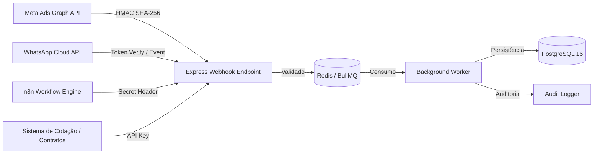

# Guia de Integrações Oficiais & Webhooks — Robô LED Partner

Este documento detalha o funcionamento, especificações técnicas, autenticação, tratamento de falhas e segurança de todas as integrações da **Plataforma Privada de Marketing Digital — Robô LED Partner**.

---

## 1. Visão Geral da Arquitetura de Integrações

Todas as integrações externas operam seguindo 4 princípios fundamentais:
1. **Segurança Criptográfica:** Validação de assinaturas HMAC SHA-256 em todos os webhooks de entrada.
2. **Idempotência:** Deduplicação de eventos usando chaves únicas (`leadId`, `eventId`, `timestamp`).
3. **Processamento Assíncrono:** Ingestão imediata de payloads com enfileiramento via **Redis + BullMQ** para processamento em background.
4. **Resiliência e Tolerância a Falhas:** Retry automático com backoff exponencial (3 tentativas: 1m, 5m, 15m) e Dead Letter Queue (DLQ).



---

## 2. Meta Marketing API & Meta Lead Ads (Graph v21.0)

### 2.1. Configuração do App no Meta for Developers
1. Acesse o [Meta for Developers](https://developers.facebook.com/) e crie um App do tipo **Negócios**.
2. Adicione os produtos: **Marketing API** e **Webhooks**.
3. Permissões requeridas do Token de Sistema (System User Token com acesso perpétuo):
   - `ads_read`
   - `ads_management`
   - `leads_retrieval`
   - `pages_read_engagement`
   - `pages_manage_ads`

### 2.2. Verificação de Webhook (Handshake GET)
O Meta realiza uma verificação inicial via `GET` no endpoint configurado:
- **Endpoint:** `GET https://marketing.roboledpartner.com.br/api/v1/webhooks/meta-leads`
- **Query Params:**
  - `hub.mode=subscribe`
  - `hub.verify_token=<META_VERIFY_TOKEN>`
  - `hub.challenge=<CHALLENGE_CODE>`
- **Resposta:** `200 OK` retornando o valor puro de `hub.challenge`.

### 2.3. Validação de Assinatura Criptográfica (POST)
Todos os payloads recebidos via `POST` contêm o cabeçalho `X-Hub-Signature-256`:
$$\text{Signature} = \text{sha256}=\text{HMAC-SHA256}(\text{Payload Raw Body}, \text{META\_APP\_SECRET})$$

```typescript
// Implementado em server/src/modules/webhooks/webhook.controller.ts
export function verifyMetaSignature(rawBody: Buffer, signatureHeader: string, appSecret: string): boolean {
  if (!signatureHeader || !signatureHeader.startsWith('sha256=')) return false;
  const hash = crypto.createHmac('sha256', appSecret).update(rawBody).digest('hex');
  const expectedSignature = `sha256=${hash}`;
  return crypto.timingSafeEqual(Buffer.from(signatureHeader), Buffer.from(expectedSignature));
}
```

### 2.4. Ingestão de Leads Automática
Ao receber o evento `leadgen`, o backend busca os dados detalhados na API Graph v21.0:
1. `GET https://graph.facebook.com/v21.0/{leadgen_id}?access_token={PAGE_ACCESS_TOKEN}`
2. Mapeamento de campos:
   - `full_name` $\rightarrow$ `Lead.name`
   - `phone_number` $\rightarrow$ `Lead.phone` e `Lead.whatsapp` (com formatação E.164 brasileira)
   - `email` $\rightarrow$ `Lead.email`
   - `tipo_evento` $\rightarrow$ `Lead.eventType` (Casamento, Debutante, Corporativo, etc.)
   - `data_evento` $\rightarrow$ `Lead.eventDate`
   - `cidade_evento` $\rightarrow$ `Lead.city`
   - `atracao_interesse` $\rightarrow$ `Lead.attraction` (Megatron, Bumblebee, Tequileiros, Espelho)
3. Salva UTMs automáticas: `utm_source=meta`, `utm_medium=paid_social`, `utm_campaign={campaign_name}`, `utm_content={ad_name}`.

---

## 3. WhatsApp Cloud API Oficial

### 3.1. Arquitetura
A integração com o WhatsApp Cloud API da Meta permite:
- Disparo de notificações de novo lead para a equipe comercial.
- Mensagem imediata de boas-vindas com apresentação em vídeo/foto da atração solicitada.
- Notificação de follow-up e orçamentos emitidos.

### 3.2. Formato de Envio de Template
```http
POST https://graph.facebook.com/v21.0/{{WHATSAPP_PHONE_NUMBER_ID}}/messages
Authorization: Bearer {{WHATSAPP_ACCESS_TOKEN}}
Content-Type: application/json

{
  "messaging_product": "whatsapp",
  "recipient_type": "individual",
  "to": "5511999999999",
  "type": "template",
  "template": {
    "name": "novo_orcamento_robo_led",
    "language": { "code": "pt_BR" },
    "components": [
      {
        "type": "body",
        "parameters": [
          { "type": "text", "text": "Camila" },
          { "type": "text", "text": "Robô Megatron de LED 3 Metros" },
          { "type": "text", "text": "15 Anos" }
        ]
      }
    ]
  }
}
```

---

## 4. n8n Workflow Automations

### 4.1. Gatilhos de Saída (Outbound Webhooks)
O sistema dispara webhooks autenticados para o n8n nos seguintes eventos:
- `lead.created`: Novo lead cadastrado (manual, Meta Ads ou Landing Page).
- `lead.status_changed`: Lead avançou de etapa no funil comercial.
- `lead.deal_won`: Contrato fechado (dispara fluxo pós-venda).
- `campaign.budget_alert`: Alerta de CPL ou gasto acima do limiar.

### 4.2. Segurança e Assinatura n8n
- **Header:** `X-Webhook-Secret: {{N8N_WEBHOOK_SECRET}}`
- **Header:** `X-Timestamp: {{UNIX_TIMESTAMP}}`
- **Validação de replay attack:** Rejeição de requisições com timestamp superior a 5 minutos de diferença.

---

## 5. Integração com Sistema de Cotação & Contratos

Para fechar o ciclo de atribuição de receita (**Closed-Loop Attribution**):
- **Endpoint:** `POST /api/v1/webhooks/quote-system`
- **Autenticação:** `Authorization: Bearer {{QUOTE_SYSTEM_API_KEY}}`
- **Payload:**
```json
{
  "quoteId": "COT-2026-089",
  "leadPhone": "+5511988887777",
  "leadEmail": "cliente@email.com",
  "attraction": "Megatron + Tequileiros",
  "contractValue": 4500.00,
  "eventDate": "2026-11-20T22:00:00Z",
  "status": "SIGNED",
  "signedAt": "2026-10-15T14:30:00Z"
}
```
- **Ação:** O backend busca o lead correspondente via telefone/e-mail, atualiza o status para `CONTRATO_FECHADO`, registra o `contractValue` e calcula o **ROAS** e **CAC** exatos da campanha de origem.

---

## 6. Provedor de Inteligência Artificial (OpenAI / Claude / Local)

### 6.1. Modos Suportados
1. **OpenAI API:** `gpt-4o` ou `gpt-4o-mini` para geração de copies de alta conversão, roteiros para Reels, legendas e ganchos de anúncios.
2. **Anthropic Claude API:** `claude-3-5-sonnet` para análise aprofundada de métricas e sugestões táticas de otimização de tráfego.
3. **Modo Fallback / Local Mock:** Caso a chave de API não esteja configurada, o sistema aciona templates inteligentes pré-compilados baseados nos dados das atrações do Robô LED Partner, mantendo a experiência fluida sem quebras.

---

## 7. Monitoramento de Saúde das Integrações

O painel de Integrações (`/integrations`) realiza health checks ativos periódicos:
- `GET /api/v1/integrations/status`
- Testa conectividade com Meta Graph API, WhatsApp Cloud API, n8n, Sistema de Cotação e Provedor de IA.
- Exibe latência em milissegundos, status (`CONNECTED`, `WARNING`, `DISCONNECTED`) e última sincronização bem-sucedida.
