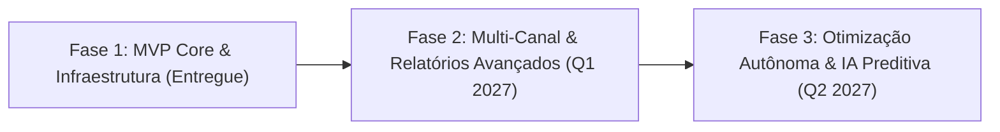

# Roadmap de Evolução e Ciclo de Vida do Produto

Este documento traça o planejamento estratégico de evolução tecnológica e funcional da **Plataforma Privada de Marketing Digital — Robô LED Partner**.

---

## 1. Visão Geral das Fases

---

## 2. Fase 1: Fundação Completa, CRM, Tráfego e Automação (100% Entregue)

- [x] **Arquitetura & Infraestrutura:**
  - Monólito modular em Node.js (TypeScript) + React (TypeScript/Vite/Tailwind).
  - PostgreSQL 16 + Prisma ORM com 22 modelos relacionais e migrações versionadas.
  - Redis 7 + BullMQ para processamento em background assíncrono.
  - Containerização completa com Docker multi-stage, Docker Compose e proxy reverso Nginx.
  - Suporte a deploy em servidor Linux / Proxmox VE com Cloudflare Zero Trust Tunnel.

- [x] **Segurança & Controle de Acesso:**
  - Hashing seguro com Argon2id.
  - Sessão com cookies HttpOnly, SameSite e proteção CSRF.
  - RBAC com perfis `ADMIN`, `MARKETING` e `READONLY`.
  - Rate limiting em rotas de autenticação e endpoints sensíveis.
  - Tela e endpoint seguro de setup inicial do primeiro administrador (`/setup-admin`).
  - Registro de auditoria completo para ações críticas.

- [x] **Dashboard Executivo:**
  - KPIs financeiros em tempo real: Investimento, Leads, CPL, CAC, ROAS, Taxa de Conversão e Lucro Líquido.
  - Filtros por Hoje, 7 dias, 30 dias, Mês Atual, Mês Anterior e Personalizado.
  - Gráficos de evolução temporal (Investimento x Leads), Funil Comercial e Performance por Atração.
  - Proteção estrita contra divisões por zero.

- [x] **CRM & Gestão de Leads:**
  - Visualizações em **Kanban Board** interativo e **Tabela Dinâmica** com ordenação e filtros.
  - Gestão de temperaturas de lead (Frio, Morno, Quente), tipos de evento e atrações de interesse.
  - Cadastro de atividades (ligações, WhatsApp, reuniões), tarefas agendadas e histórico de interações.
  - Importação e Exportação de leads em formato CSV com detecção de duplicatas.

- [x] **Gestão de Tráfego Pago & Meta Ads:**
  - Integração com a Meta Marketing API (Graph v21.0) para leitura de Campanhas, Conjuntos e Anúncios.
  - Cadastro e controle de despesas manuais de mídia paga e orçamento mensal.
  - Cálculo de métricas analíticas: CTR, CPC, CPM, Frequência e ROAS.

- [x] **Instagram & Estúdio de Conteúdo:**
  - Biblioteca de mídias categorizada por atração (Robô Megatron, Bumblebee, Tequileiros, Espelho Mágico).
  - Calendário editorial com visualizações em Mês e Lista.
  - Fluxo de aprovação de publicações (`Rascunho`, `Aguardando Aprovação`, `Aprovado`, `Agendado`, `Publicado`).

- [x] **Automações & Webhooks:**
  - Receptor de webhooks do Meta Lead Ads com verificação criptográfica HMAC SHA-256.
  - Gatilhos de saída autenticados para fluxos no n8n e notificações via WhatsApp Cloud API.
  - Receptor de conversão para o Sistema de Cotação e Contratos do Robô LED Partner.

- [x] **Assistente de Inteligência Artificial:**
  - Gerador de copies persuasivas para Instagram (Reels, Carrossel, Feed).
  - Gerador de ganchos e roteiros de alta conversão para anúncios no Meta Ads.
  - Qualificador e pontuador inteligente de leads com base no perfil do evento.

---

## 3. Fase 2: Expansão Multi-Canal e Relatórios Avançados (Previsto para Q1/2027)

- [ ] **Integração com Google Ads API:**
  - Conexão com campanhas de Rede de Pesquisa e YouTube Ads.
  - Unificação de métricas de tráfego do Google e Meta no mesmo painel.
- [ ] **Construtor Visual de Relatórios Customizados:**
  - Geração automatizada de relatórios em PDF com identidade visual da Robô LED Partner.
  - Envio agendado semanal/mensal para a diretoria via e-mail e WhatsApp.
- [ ] **Atribuição Multi-Toque Avançada (W-Shaped & Time Decay):**
  - Análise detalhada da jornada do cliente em múltiplos pontos de contato antes do fechamento do contrato.
- [ ] **Chatbot WhatsApp com Atendimento Integrado:**
  - Caixa de entrada compartilhada no CRM para resposta direta aos leads pelo painel web.

---

## 4. Fase 3: Otimização Autônoma e IA Preditiva (Previsto para Q2/2027)

- [ ] **Regras Autônomas de Tráfego (Auto-Scaling):**
  - Pausa automática de anúncios com CPL superior ao teto configurado.
  - Aumento automático de orçamento em conjuntos de anúncios com ROAS superior a 5x.
- [ ] **Detecção de Fadiga Criativa:**
  - Alerta antecipado quando a frequência de um anúncio ultrapassar 3.5 com queda acentuada de CTR.
- [ ] **Transcrição e Resumo de Áudios de WhatsApp (Whisper AI):**
  - Transcrição automática de áudios enviados pelos clientes com extração de data do evento, local e número de convidados direto para os campos do lead.
- [ ] **Previsão de Demanda e Sazonalidade:**
  - Modelo preditivo para antecipar picos de eventos (ex: temporada de debutantes e casamentos de fim de ano).

---

## 5. Política de Versionamento

O projeto adota o padrão **Semantic Versioning 2.0.0 (SemVer)**:
- `MAJOR` (ex: 2.0.0): Mudanças estruturais na arquitetura ou quebras de compatibilidade de APIs.
- `MINOR` (ex: 1.1.0): Novas funcionalidades mantendo total compatibilidade retroativa.
- `PATCH` (ex: 1.0.1): Correções de bugs, ajustes de desempenho e atualizações de segurança.
